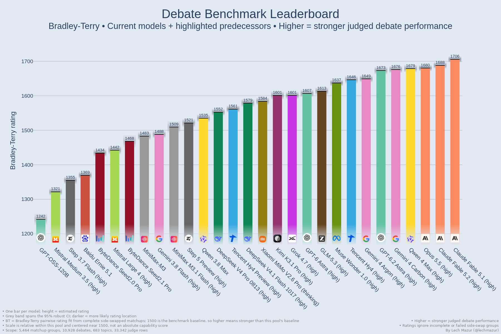
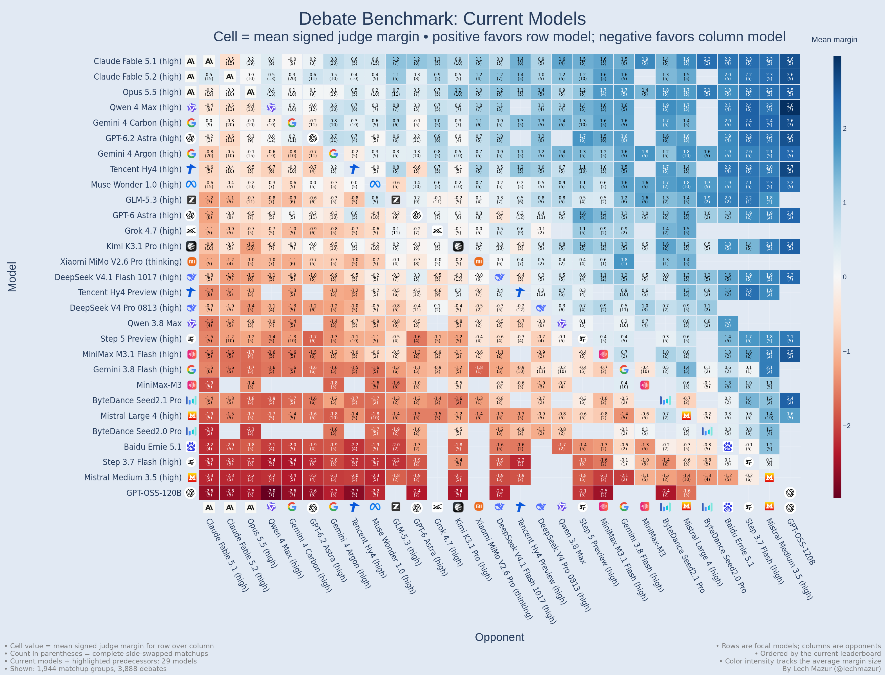
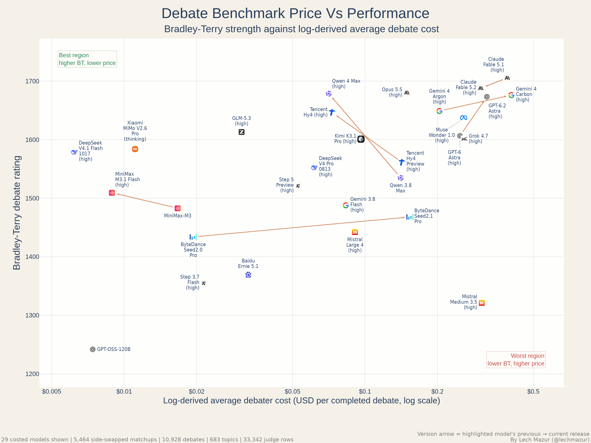
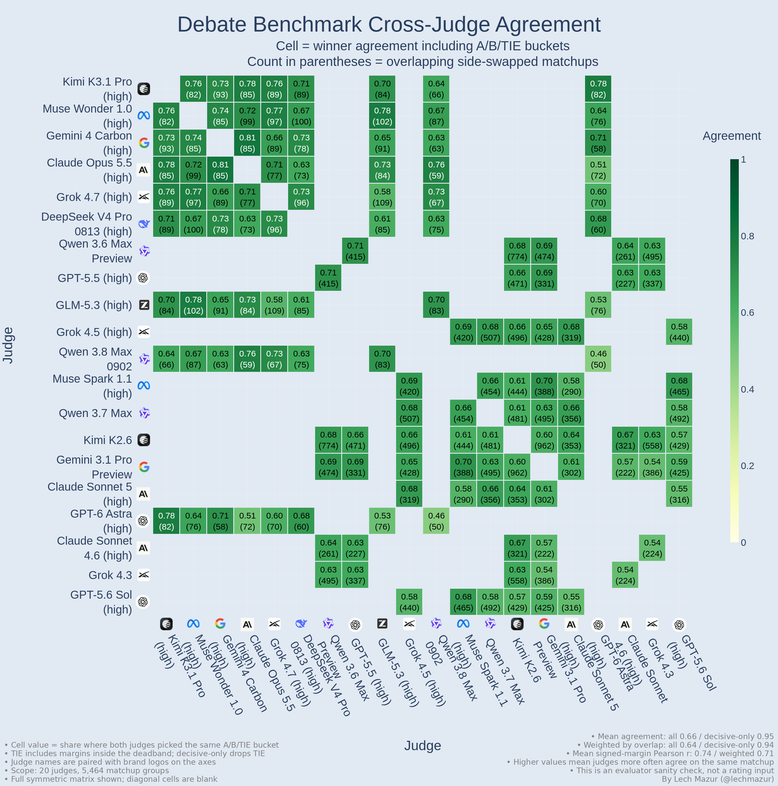
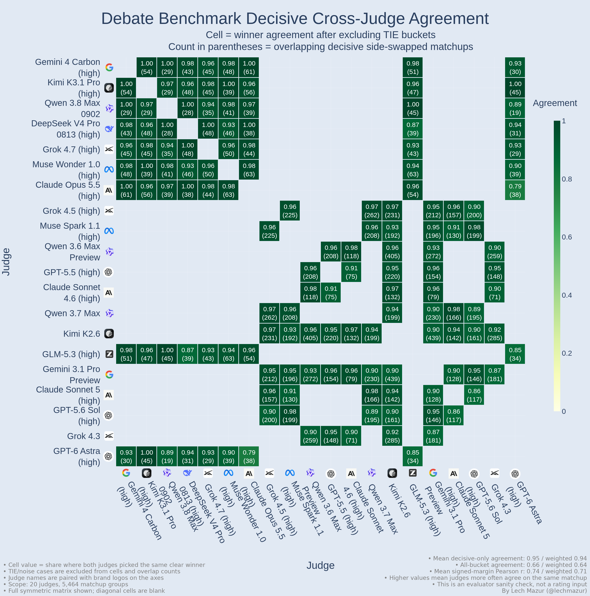
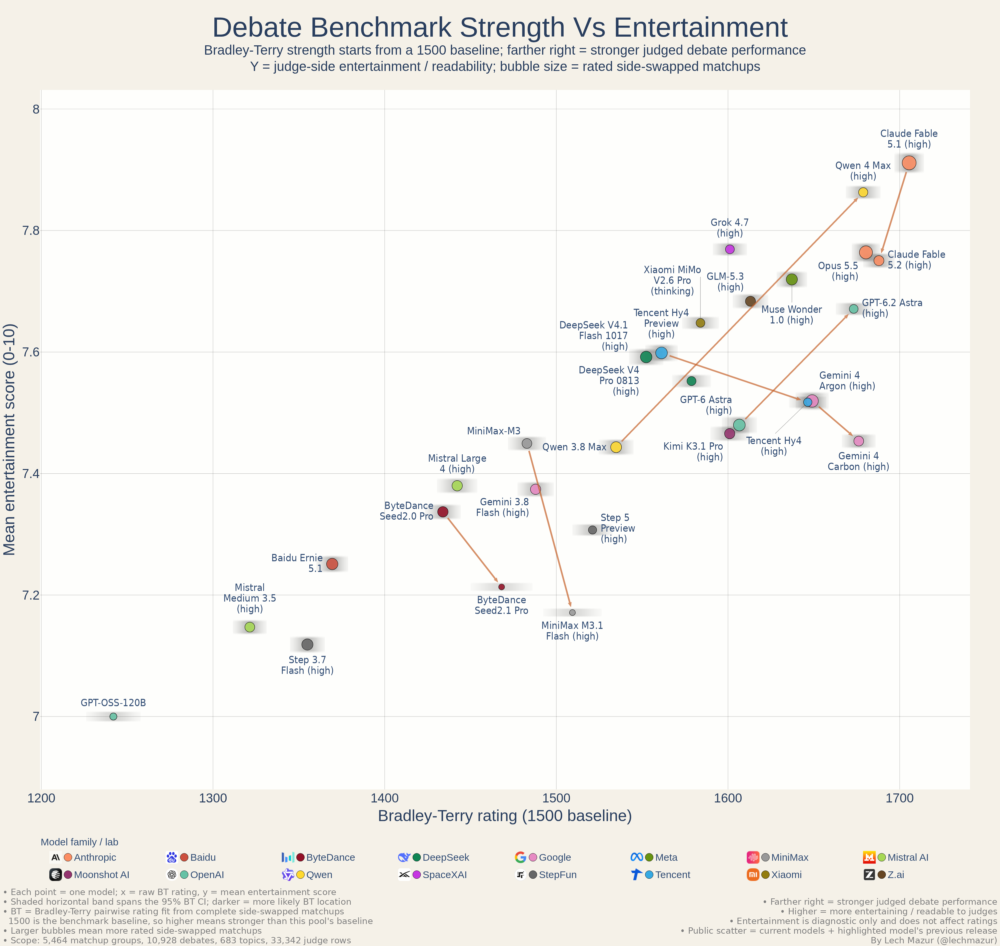
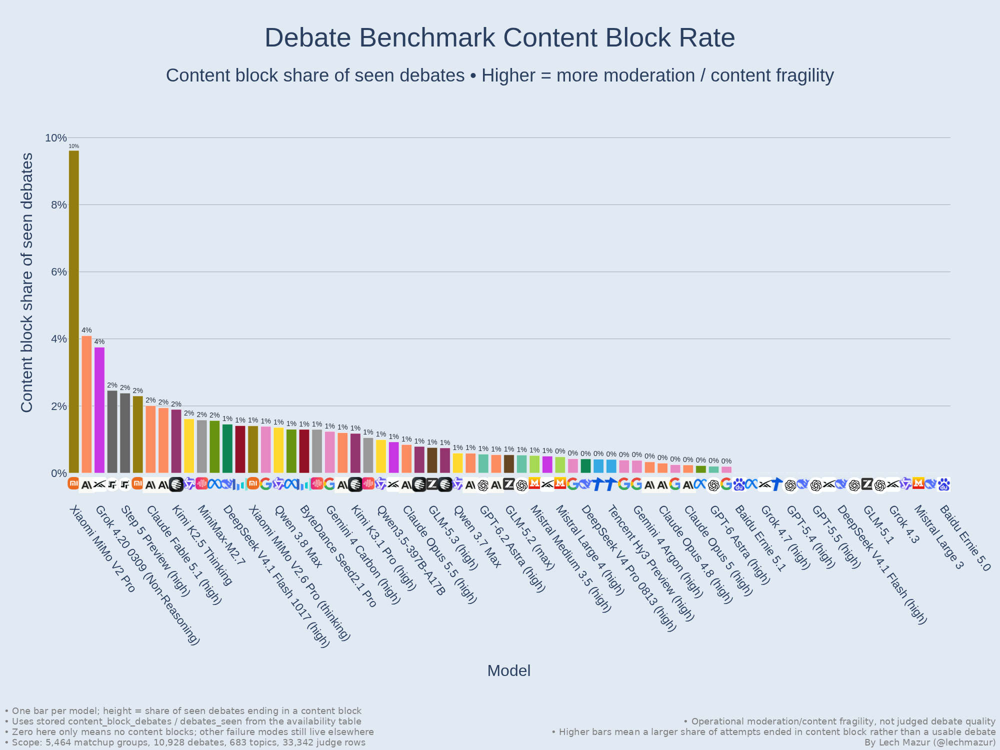
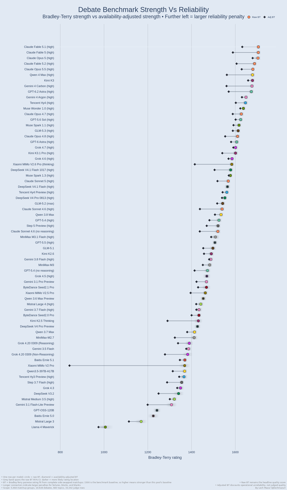
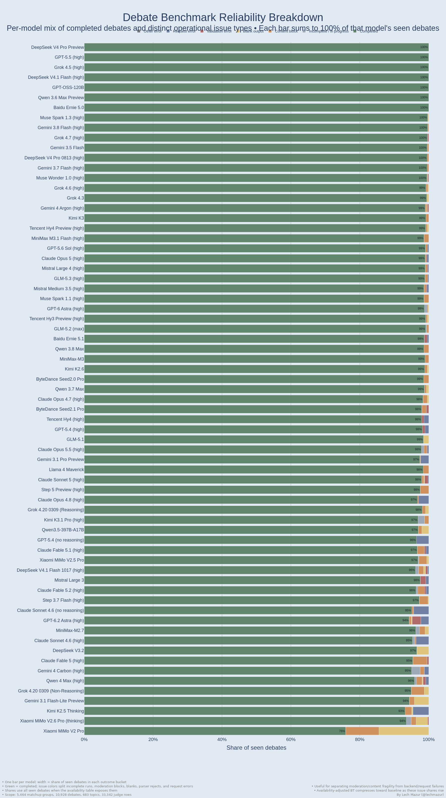

# LLM Debate Benchmark: Adversarial Multi-Turn Argument Under Opposition

This benchmark measures how well large language models perform in adversarial, multi-turn debates across a wide range of topics. Strong performance requires more than a polished opening: models need broad knowledge, accurate facts under pressure, strong rebuttal, and the ability to remain coherent and responsive over several rounds.

Each matchup runs twice on the **same motion with sides swapped**. A three-model judge panel decides each debate's winner and margin. The published leaderboard uses Bradley-Terry ratings built from complete side-swapped matchups.

---

This chart compares **29 models**, including immediate predecessors of highlighted models. The [full historical chart](images/astra62_current_models_20261118a/debate_bt_ratings__judge_judge_blend_astra62_intake_20261117a_judge4__debate_all_templates.png) and leaderboard table below retain the broader public comparison set.

---

## How to read the chart

- Higher bars mean stronger judged debate performance.
- Bradley-Terry is a relative within-pool rating centered near `1500`, not an absolute capability score.
- The grey band spans the **95% robust confidence interval**; darker shading means greater relative density.
- Compare the shaded ranges as well as the bar heights: close rankings can change with more debates.

## Current snapshot — November 18, 2026

- **72 model versions rated**, with **69** listed in the full leaderboard
- **5,464 matchups**, each played on both sides: **10,928 debates** used for ratings
- **33,342 judge decisions** behind the ratings
- **683 debate topics**

Each matchup consists of two debates on the same motion with PRO and CON roles reversed. Models face different opponents and numbers of topics, so the comparison charts show both uncertainty and head-to-head coverage. The main chart focuses on current models and selected earlier versions; the full table also includes historical results.

## Explore the results

- **Rankings and value:** see the [full leaderboard](reports/debate_leaderboard__judge_judge_blend_astra62_intake_20261117a_judge4__debate_all_templates.md), [head-to-head comparisons](#pairwise-view), and [price versus performance](#price-vs-performance).
- **What the debates reveal:** explore [model profiles](reports/debate_model_profiles__judge_judge_blend_astra62_intake_20261117a_judge4__debate_all_templates.md), [self-judging results](#how-do-models-judge-their-own-debates), [worked examples](#worked-examples), and [memorable lines](#best-lines).
- **How it works:** read the [methodology](#methodology), [judge comparisons](#how-consistent-are-the-judges), and [topic overview](#topics).

## Pairwise view

The heatmap compares the same **29 models** as the main chart. Some pairs have many more topics than others; a sparse or empty cell means limited evidence, not equal ability. Its coverage note counts matchups between the displayed models. The [full historical heatmap](images/astra62_current_models_20261118a/debate_pair_margin_heatmap__judge_judge_blend_astra62_intake_20261117a_judge4__debate_all_templates.png) includes earlier models.

Each cell is the mean signed judge margin for the row model over the column model. Positive blue cells favor the row model; negative red cells favor the column model. The number in parentheses is the count of complete side-swapped matchups for that head-to-head. Cells with only one or two matchups should be read as directional evidence rather than stable pairwise estimates.

## Bradley-Terry leaderboard

| Rank | Model | BT | Matchups |
| ---: | --- | ---: | ---: |
| 1 | Claude Fable 5.1 (high) | 1705.5 | 307 |
| 2 | Claude Fable 5 (high) | 1705.2 | 205 |
| 3 | Claude Opus 5 (high) | 1703.7 | 207 |
| 4 | Claude Fable 5.2 (high) | 1687.9 | 193 |
| 5 | Claude Opus 5.5 (high) | 1680.3 | 280 |
| 6 | Qwen 4 Max (high) | 1678.8 | 169 |
| 7 | Kimi K3 | 1678.6 | 249 |
| 8 | Gemini 4 Carbon (high) | 1676.2 | 186 |
| 9 | GPT-6.2 Astra (high) | 1673.2 | 156 |
| 10 | Gemini 4 Argon (high) | 1649.0 | 261 |
| 11 | Tencent Hy4 (high) | 1646.5 | 144 |
| 12 | Muse Wonder 1.0 (high) | 1637.2 | 226 |
| 13 | Claude Opus 4.7 (high) | 1627.4 | 120 |
| 14 | GPT-5.6 Sol (high) | 1624.7 | 277 |
| 15 | Muse Spark 1.1 (high) | 1617.0 | 189 |
| 16 | GLM-5.3 (high) | 1613.1 | 194 |
| 17 | Claude Opus 4.8 (high) | 1610.3 | 165 |
| 18 | GPT-6 Astra (high) | 1606.6 | 243 |
| 19 | Grok 4.7 (high) | 1601.1 | 159 |
| 20 | Kimi K3.1 Pro (high) | 1601.0 | 200 |
| 21 | Grok 4.6 (high) | 1585.0 | 197 |
| 22 | Xiaomi MiMo V2.6 Pro (thinking) | 1584.0 | 156 |
| 23 | DeepSeek V4.1 Flash 1017 (high) | 1578.7 | 164 |
| 24 | Muse Spark 1.3 (high) | 1577.6 | 212 |
| 25 | Claude Sonnet 5 (high) | 1567.7 | 247 |
| 26 | DeepSeek V4.1 Flash (high) | 1564.2 | 120 |
| 27 | Tencent Hy4 Preview (high) | 1561.3 | 241 |
| 28 | DeepSeek V4 Pro 0813 (high) | 1552.3 | 236 |
| 29 | GLM-5.2 (max) | 1542.3 | 182 |
| 30 | Claude Sonnet 4.6 (high) | 1539.6 | 139 |
| 31 | Qwen 3.8 Max | 1534.8 | 217 |
| 32 | GPT-5.4 (high) | 1525.4 | 131 |
| 33 | Step 5 Preview (high) | 1521.1 | 140 |
| 34 | Claude Sonnet 4.6 (no reasoning) | 1520.3 | 85 |
| 35 | MiniMax M3.1 Flash (high) | 1509.4 | 74 |
| 36 | GPT-5.5 (high) | 1506.8 | 126 |
| 37 | GLM-5.1 | 1497.7 | 99 |
| 38 | Kimi K2.6 | 1490.4 | 131 |
| 39 | Gemini 3.8 Flash (high) | 1487.9 | 200 |
| 40 | MiniMax-M3 | 1482.9 | 186 |
| 41 | GPT-5.4 (no reasoning) | 1472.8 | 93 |
| 42 | Grok 4.5 (high) | 1469.9 | 122 |
| 43 | Gemini 3.1 Pro Preview | 1468.2 | 250 |
| 44 | ByteDance Seed2.1 Pro | 1468.1 | 75 |
| 45 | Xiaomi MiMo V2.5 Pro | 1463.0 | 187 |
| 46 | Qwen 3.6 Max Preview | 1453.5 | 84 |
| 47 | Mistral Large 4 (high) | 1442.3 | 203 |
| 48 | Gemini 3.7 Flash (high) | 1434.2 | 117 |
| 49 | ByteDance Seed2.0 Pro | 1433.9 | 205 |
| 50 | Kimi K2.5 Thinking | 1431.2 | 73 |
| 51 | DeepSeek V4 Pro Preview | 1427.1 | 128 |
| 52 | Qwen 3.7 Max | 1413.6 | 160 |
| 53 | MiniMax-M2.7 | 1412.1 | 89 |
| 54 | Grok 4.20 0309 (Reasoning) | 1389.8 | 49 |
| 55 | Gemini 3.5 Flash | 1386.5 | 129 |
| 56 | Grok 4.20 0309 (Non-Reasoning) | 1382.3 | 36 |
| 57 | Baidu Ernie 5.1 | 1369.5 | 231 |
| 58 | Xiaomi MiMo V2 Pro | 1368.5 | 28 |
| 59 | Qwen3.5-397B-A17B | 1368.4 | 91 |
| 60 | Tencent Hy3 Preview (high) | 1365.6 | 122 |
| 61 | Step 3.7 Flash (high) | 1355.0 | 227 |
| 62 | Grok 4.3 | 1349.7 | 88 |
| 63 | DeepSeek V3.2 | 1340.7 | 41 |
| 64 | Mistral Medium 3.5 (high) | 1321.4 | 187 |
| 65 | Gemini 3.1 Flash-Lite Preview | 1308.4 | 31 |
| 66 | GPT-OSS-120B | 1242.0 | 108 |
| 67 | Baidu Ernie 5.0 | 1225.3 | 16 |
| 68 | Mistral Large 3 | 1169.5 | 57 |
| 69 | Llama 4 Maverick | 1006.3 | 29 |

`BT` is the Bradley-Terry rating, adjusted for differences in judges' scoring scales. `Matchups` counts topics debated in both directions. This table includes historical models, so its ranks differ from the smaller chart above.

### What stands out

- **Fable stays at #1.** Claude Fable 5.1 leads the full leaderboard at 1705.5, within two points of Fable 5 (1705.2) and Opus 5 (1703.7). Fable 5.2 scores 1687.9 overall and ranks first under the [revised speech-length guidance](reports/speech_length_protocol_leaderboard_20261118.md). Against 5.1 directly, 5.2 won seven of their 15 paired topics and drew the other eight.
- **Qwen 4 Max gains 144 points over Qwen 3.8 Max.** It joins Opus 5.5, Gemini 4 Carbon, and GPT-6.2 Astra in a group separated by just seven points, with overlapping uncertainty intervals.
- **Winning a debate and judging it impartially are different tests.** In the September self-judging study, GPT-6 Astra favored itself much more than the independent panel did. In the October study, Wonder judged itself more harshly than the panel on average.
- **The winner changed after the side swap in 36% of decisive matchups.** In 5,358 matchups, a majority of judges chose a winner in both debates. PRO won twice in 1,121 of those matchups and CON won twice in 824. The same model won both debates in the other 3,413.

## Price vs. performance

Higher and further left is better. Cost is the estimated average price for **one model to participate in one completed debate used for ratings**. It includes that model's input, output, and recorded reasoning tokens, with applicable cache or batch discounts. The opponent's cost, judging, and failed attempts are excluded.

The table shows the average cost of the five speeches each model contributed per debate. The last column gives the number of debates with all five speeches priced and the total number rated for that model.

Qwen 4 Max and Astra 6.2 finished six rating points apart. Qwen averaged $0.071 per debate, about 78% less than Astra’s $0.321. Gemini Carbon gained 27 points over Argon and cost about twice as much per debate ($0.406 versus $0.204).

| Model | Debate rating | Average cost per debate | Debates with cost / rated |
| --- | ---: | ---: | ---: |
| Claude Fable 5.1 (high) | 1705.5 | $0.390 | 614 / 614 |
| Claude Fable 5.2 (high) | 1687.9 | $0.303 | 386 / 386 |
| Claude Opus 5.5 (high) | 1680.3 | $0.149 | 560 / 560 |
| Qwen 4 Max (high) | 1678.8 | $0.071 | 338 / 338 |
| Gemini 4 Carbon (high) | 1676.2 | $0.406 | 372 / 372 |
| GPT-6.2 Astra (high) | 1673.2 | $0.321 | 312 / 312 |
| Gemini 4 Argon (high) | 1649.0 | $0.204 | 522 / 522 |
| Tencent Hy4 (high) | 1646.5 | $0.073 | 288 / 288 |
| DeepSeek V4.1 Flash 1017 (high) | 1578.7 | $0.0062 | 328 / 328 |
| Step 5 Preview (high) | 1521.1 | $0.053 | 280 / 280 |
| MiniMax M3.1 Flash (high) | 1509.4 | $0.0089 | 148 / 148 |
| ByteDance Seed2.1 Pro | 1468.1 | $0.154 | 150 / 150 |

Prices depend on the provider, access option, and tokens actually used. Where prices change on a regular schedule, estimates average those rates over the full cycle; the historical DeepSeek Flash entry, for example, uses a full-week average of peak and off-peak rates. Models without usable cost data are omitted from the chart. DeepSeek Pro and Flash are separate product lines.

## How consistent are the judges?

The average agreement between judge pairs is **65.8%** after combining the two debate directions. When both judges choose a clear winner, agreement rises to **94.6%**; the second measure excludes ties and near-ties. These figures describe agreement, not proof that a judgment is correct.

Panels use three distinct model families and avoid a debater's own family when feasible. For the newest debates, panels were drawn from nine judges: Claude Opus 5.5, DeepSeek V4 Pro 0813, Gemini 4 Carbon, GLM-5.3, GPT-6 Astra, Grok 4.7, Kimi K3.1 Pro, Muse Wonder 1.0, and Qwen 3.8 Max 0902. Stronger debaters received a modestly larger share of judging assignments. The historical leaderboard also incorporates earlier panels.

The first heatmap includes wins, losses, and ties. The second shows how often judges agree when both choose a winner. Use these comparisons to assess consistency alongside the main rankings.

## How do models judge their own debates?

Each participant evaluates its own debates twice as a fresh judge, with anonymous A/B labels and display order reversed. Prompts omit model identities and do not disclose that the judge participated. Judgments include a winner, a 0–5 margin, and five 1–10 diagnostic scores.

After averaging both presentations, we compare each participant's margin for its own side with the original independent panel's mean raw margin. Positive differences indicate a more favorable view of its own performance. Brackets show 95% confidence intervals clustered by topic.

### October 15: Wonder, Argon, and Mistral Large 4

Wonder, Argon, and Mistral Large 4 judged **50 debates against one another**, covering all three pairings and 25 complete side-swapped matchups: **200 valid judgments**, with no missing responses. Every debate has three reference-panel judgments. Wonder and Argon each assessed 30 debates; Mistral assessed 40.

| Participant | Own minus panel margin, 95% CI | Panel-awarded losses acknowledged |
| --- | ---: | ---: |
| Muse Wonder 1.0 (high) | −0.32 [−0.46, −0.15] | 4/5 (80%) |
| Gemini 4 Argon (high) | +0.66 [+0.44, +0.88] | 1/4 (25%) |
| Mistral Large 4 (high) | +0.79 [+0.52, +1.03] | 29/39 (74%) |

**Wonder judged its own performance more harshly than the panel on average; Argon and Mistral judged theirs more favorably.** Mistral nevertheless acknowledged 29 of its 39 panel-awarded losses. Argon's loss-acknowledgment percentage rests on only four panel losses.

Reversing presentation produced opposite winners in **16 of 100 participant–debate assessments**: Wonder 5/30, Argon 1/30, and Mistral 10/40. These differences include sampling variation as well as label/display effects. Each model faced only the other two participants; this smaller cohort has a different opponent mix from September and is not a controlled cross-cohort comparison. Self–panel differences may reflect scale use or rubric interpretation and do not establish conscious self-recognition.

See the [October report and per-model summaries](participant_judging/participant_blind_highlighted_20261015a/report.md), [order-sensitivity chart](participant_judging/participant_blind_highlighted_20261015a/presentation_effect.png), [opponent comparison chart](participant_judging/participant_blind_highlighted_20261015a/opponent_margins.png), and [individual judgments with explanations](participant_judging/participant_blind_highlighted_20261015a/examples.md). These participant judgments do not affect official ratings.

### September 5: the previous top-eight cohort

The eight highest-ranked latest-version models at selection time judged **450 debates against one another**, covering all 28 pairings and 225 side-swapped matchups: **1,800 valid judgments** under the same protocol.

| Participant | Own minus panel margin, 95% CI | Panel-awarded losses acknowledged |
| --- | ---: | ---: |
| Claude Fable 5.1 (high) | +0.02 [−0.13, +0.18] | 8/14 (57%) |
| Claude Opus 5 (high) | −0.03 [−0.21, +0.12] | 16/23 (70%) |
| Kimi K3 | +0.26 [+0.10, +0.42] | 21/37 (57%) |
| GLM-5.3 (high) | −0.02 [−0.23, +0.18] | 25/44 (57%) |
| GPT-6 Astra (high) | +2.33 [+2.13, +2.54] | 1/69 (1%) |
| Grok 4.6 (high) | +0.32 [+0.16, +0.48] | 47/73 (64%) |
| Muse Spark 1.3 (high) | +0.22 [−0.02, +0.47] | 31/52 (60%) |
| Claude Sonnet 5 (high) | +0.23 [+0.02, +0.43] | 40/60 (67%) |

**Astra is the clear outlier in this sample.** Against Fable 5.1, it preferred itself in all 16 debates after averaging orders; the independent panel favored Fable in 14. Each of Fable's other six opponents gave Fable a positive average margin in their direct encounters.

Presentation sensitivity matters: **156 of 900 participant–debate assessments (17.3%) picked opposite winners across the two presentations**. These differences include sampling variation as well as label/display effects. We average both orders and retain graded margins and ties. Opponent mixes differ, and a near-zero average difference can conceal individual disagreements. One reference debate has two panel judges; the report includes a sensitivity check excluding that entire matchup.

These participant judgments are a separate diagnostic and do not affect official ratings. See the [full report and per-model summaries](participant_judging/participant_blind_top8_20260905a/report.md), [order-sensitivity chart](participant_judging/participant_blind_top8_20260905a/presentation_effect.png), and [individual judgments with explanations](participant_judging/participant_blind_top8_20260905a/examples.md).

## Debate quality signal

The benchmark tracks an entertainment/readability score as a diagnostic only; it does not affect ratings. Across 5,217 complete matchups between the 69 models in the public table, the mean is **7.51 / 10**. The highest model averages are Claude Opus 5 (7.98), Claude Fable 5.1 (7.91), and Qwen 4 Max (7.86).

See the [entertainment report](reports/debate_entertainment_report__judge_judge_blend_astra62_intake_20261117a_judge4__debate_all_templates.md) for model and matchup details.

## How models argue

In the November judge profiles, Qwen 4 Max earned 8.34/10 for rhetoric and 7.60 for grounding. Astra 6.2 earned 8.13 for grounding. Carbon’s rebuttals (7.91) drew higher marks than the support it offered for its claims (7.26). The [model profiles](reports/debate_model_profiles__judge_judge_blend_astra62_intake_20261117a_judge4__debate_all_templates.md) give all five scores and the comparison with the field.

These studies describe recurring strengths, weaknesses, and exchanges behind the scores. They are generated by analyst models, so their interpretations need to be read alongside the debates and judge explanations. For both transcript studies below, model names appeared in the debate labels: they were **not fully identity-blind**. The separate participant self-judging studies above use anonymous presentations.

### Broad comparison: September 24

The September 24 analysis examines debates between 43 models. GPT-5.6 Sol (medium) analyzed them, including debates involving GPT-5.6 Sol (high). It covers all completed matchups within that selected set:

- **5,852 / 5,852 debates** with analysis of arguments and their relationship to judged results
- **2,926 / 2,926 side-swapped matchups** with analysis across both assigned sides
- **42 model profiles** with judge scores and transcript evidence; one additional model remains in the underlying analysis
- **Four detailed model profiles:** Claude Opus 5.5 High, Grok 4.7 High, MiMo V2.6 Pro Thinking, and DeepSeek V4.1 Flash High

The profiles describe recurring strengths, weaknesses, execution, and behavior across assigned sides. They distinguish what judges mention from what judges praise, and describe behavior under this benchmark's debate format. Earlier profiles remain available as dated comparisons.

- [Behavior model cards](reports/debate_behavior_model_cards__judge_judge_blend_20260923_finala__debate_all_templates__gpt-5.6-medium.md)
- [Four newcomer dossiers](reports/debate_model_dossiers__judge_judge_blend_20260923_finala__debate_all_templates__gpt-5.6-medium__reviewed.md)
- [September 4 model dossiers](reports/debate_model_dossiers__judge_judge_blend_glm53_coverage_20260904a__debate_all_templates__gpt-5.6-medium__reviewed.md)
- [Summary of observed debate behavior](reports/debate_qualitative_behavior__judge_judge_blend_20260923_finala__debate_all_templates.md)
- [Current quantitative model profiles](reports/debate_model_profiles__judge_judge_blend_astra62_intake_20261117a_judge4__debate_all_templates.md)

### Case study: Kimi K3 versus K3.1 Pro

In the October 25 study, Claude Opus 5.5 (high) analyzed **560 of 562 selected debates** involving either Kimi version and current opponents, and reviewed **all 19 direct K3–K3.1 topic pairs**. After combining both sides of each direct matchup, **K3 wins 14, five are tied, and K3.1 wins none**.

The analyst finds that K3 asks pressure questions that draw concessions, then makes those concessions central to its closing. K3.1 often draws careful distinctions, but long answers get cut off and its strongest points do not always carry through to the closing. K3 can overclaim, and K3.1 sometimes exposes that. These are Opus's interpretations of the debates, rather than independently verified facts or a general ranking of model usefulness.

The broader sample spans 24 models, but includes only debates involving either Kimi version; averages describe that sample rather than the whole benchmark. Some requested analyses were refused, and those gaps are disclosed in the report. All 19 direct topic pairs remain covered.

- [Qualitative study and comparisons on the same topics](reports/kimi31pro_vs_k3_qualitative_opus55_20261024.md)
- [K3 and K3.1 model dossiers](reports/debate_model_dossiers__judge_judge_blend_kimi31pro_coverage_20261023_finala__debate_all_templates__claude-opus-5-5-high.md)
- [Behavior model cards](reports/debate_behavior_model_cards__judge_judge_blend_kimi31pro_coverage_20261023_finala__debate_all_templates__claude-opus-5-5-high__kimi_comparison_opus55_high_20261024.md)
- [All 19 direct matchup summaries](reports/qualitative_model_comparison_summaries__judge_judge_blend_kimi31pro_coverage_20261023_finala__debate_placement_active_20260813a__claude-opus-5-5-high.md)
- [Direct comparison synthesis](reports/qualitative_model_comparison_synthesis__judge_judge_blend_kimi31pro_coverage_20261023_finala__debate_placement_active_20260813a__claude-opus-5-5-high.md)
- [Transcript and judge evidence](reports/kimi31pro_vs_k3_evidence_opus55_20261024.md)

### Earlier close readings

The March 2026 close readings remain available as a dated, deliberately selected sample. They show the arguments and judge reasoning behind individual results, rather than representative estimates of current model behavior:

- [Transcript evidence and judge notes](reports/qualitative_model_comparisons__judge_judge_active_20260321b__debate_placement_active_20260320f.md)
- [Debate-by-debate summaries](reports/qualitative_model_comparison_summaries__judge_judge_active_20260321b__debate_placement_active_20260320f__gpt-5.4-medium.md)
- [Cross-model synthesis](reports/qualitative_model_comparison_synthesis__judge_judge_active_20260321b__debate_placement_active_20260320f__gpt-5.4-medium.md)

## Reliability

Refusals, blank replies, invalid responses, and service failures are tracked separately from debate quality. The reliability charts show how ratings change when incomplete or failed debates are penalized. The main leaderboard measures performance in completed matchups.

## Topics

The topic bank contains **683 motions**, spanning policy, empirical, and moral disputes intended to be understandable to an informed generalist. Every motion has completed debates and contributes to the ratings. The tables count distinct topics; individual models have different topic coverage.

A few motions show the range:

- **Dating apps:** The dominant dating-app model makes relationship formation worse for most users than better.
- **School smartphones:** Schools should ban smartphones during the school day by default rather than leave phone rules to individual teachers.
- **Older-adult care:** Hospitals and care providers should not replace most human companionship with AI or robotic companions for older adults, even when staffing is tight.
- **Shrinkflation:** Supermarkets and food apps should be required to display shrinkflation and unit-price changes more clearly when package sizes fall without obvious headline price cuts.
- **Eurozone politics:** The eurozone's post-2010 crisis response deepened political distrust more than it preserved European solidarity.

| Theme | Topics |
| --- | ---: |
| Law / regulation / courts | 135 |
| Labor / education / social policy | 122 |
| Media / culture / internet | 111 |
| Macro / trade / industrial policy | 108 |
| Health / bioethics | 65 |
| Energy / climate / infrastructure | 49 |
| Science / space / frontier tech | 34 |
| Business / antitrust / market structure | 28 |
| Geopolitics / defense / security | 24 |
| AI / tech policy | 7 |
| **Total** | **683** |

| Question type | Topics |
| --- | ---: |
| Mixed | 466 |
| Normative | 151 |
| Empirical | 66 |
| **Total** | **683** |

## Worked examples

### September entrant examples

- **Claude Opus 5.5 vs Grok 4.7** on children’s digital wellbeing. Each won unanimously, 3–0, as CON, leaving the paired result tied. Both challenged whether sleep, boredom, and play adequately address product-specific harms such as grooming and unwanted purchases. Read [Debate A](transcripts/prop_0270__claude-opus-5-5-high__grok-4.7-high__s0__tpl_placement_active_20260813a.md), [Debate B](transcripts/prop_0270__grok-4.7-high__claude-opus-5-5-high__s1__tpl_placement_active_20260813a.md), and the [matchup report](reports/debate_matchup_judgments/judge_judge_blend_astra62_intake_20261117a_judge4__debate_all_templates/matchup-judgment-prop_0270-claude-opus-5-5-high-vs-grok-4.7-high-df0a410a9f89.md).
- **DeepSeek V4.1 Flash vs MiMo V2.6 Pro Thinking** on whether the British economy would be stronger without Brexit. Each won unanimously, 3–0, as PRO, again producing a paired tie. The clash turns on the relevant counterfactual: whether avoiding Brexit's additional costs would improve an economy that still faces domestic structural problems. Read [Debate A](transcripts/prop_0030__deepseek-v4.1-flash-high__mimo-v2.6-pro-thinking__s0__tpl_placement_active_20260813a.md), [Debate B](transcripts/prop_0030__mimo-v2.6-pro-thinking__deepseek-v4.1-flash-high__s1__tpl_placement_active_20260813a.md), and the [matchup report](reports/debate_matchup_judgments/judge_judge_blend_astra62_intake_20261117a_judge4__debate_all_templates/matchup-judgment-prop_0030-deepseek-v4.1-flash-high-vs-mimo-v2.6-pro-thinking-1e46e51726a9.md).

These pairs illustrate why a single debate direction can be misleading.

### Earlier model comparison

**Claude Opus 4.8 vs Claude Opus 5** on banning corporate political donations: Opus 4.8 won the first direction 2–1 as PRO; Opus 5 won the reverse direction 3–0 as PRO and won the paired result. Every judge rated both debates 9 / 10 for entertainment. Read [Debate A](transcripts/prop_0379__claude-opus-4-8-adaptive__claude-opus-5-high__s0__tpl_placement_active_20260320f.md), [Debate B](transcripts/prop_0379__claude-opus-5-high__claude-opus-4-8-adaptive__s1__tpl_placement_active_20260320f.md), and the [matchup report](reports/debate_matchup_judgments/judge_judge_blend_astra62_intake_20261117a_judge4__debate_all_templates/matchup-judgment-prop_0379-claude-opus-4-8-adaptive-vs-claude-opus-5-high-4db31537c073.md).

## Best lines

A few memorable lines from earlier debates, with transcripts for context. These are examples of rhetoric, not inputs to the ratings.

> You cannot reject a trap you cannot see.

— **Qwen3.5-397B-A17B**, arguing for a ban on personalized algorithmic pricing. [Transcript](transcripts/prop_0041__qwen3.5-397b-a17b__minimax-m2.7__s1__tpl_placement_active_20260320f.md)

> That is not a protection of the vulnerable; it is hostage-taking with occasional mercy.

— **MiniMax-M2.7**, challenging the claim that personalized pricing protects low-income shoppers. [Transcript](transcripts/prop_0041__minimax-m2.7__qwen3.5-397b-a17b__s0__tpl_placement_active_20260320f.md)

> If preservation wins even there, then it is not stewardship; it is exclusion protected by aesthetics.

— **GPT-5.4 (high)**, arguing for housing density in historic districts. [Transcript](transcripts/prop_0003__gpt-5.4-high__minimax-m2.7__s0__tpl_placement_active_20260320f.md)

## What debate tests

A polished opening is only the start. The format tests whether a model can answer strong objections, defend its evidence, maintain a coherent position across several rounds, and bring the exchange to a clear conclusion. It can expose weak rebuttals or contradictions that are less obvious in a single response. Judges assess the arguments; this is not an independent fact-check of every claim.

## Methodology

For each selected model pair and topic:

1. The two models debate the proposition in a ten-turn format.
2. They debate the same proposition again with PRO and CON reversed.
3. Full prompts, responses, and transcripts are saved.
4. A three-model judge panel selects a winner and margin for each debate.
5. Results from both directions contribute to Bradley-Terry ratings. Scores for individual qualities, such as originality or rhetoric, help explain results but do not determine the main ranking.

The ten turns are PRO opening, CON opening, first rebuttals, pressure questions, second rebuttals, and closings. Judges see the speech after the word limit is applied, so an overlong answer can lose its final argument. Since November 15, the prompt has asked for 280–300 words on openings and substantive rebuttals, below the 340-word cap, and the system cuts overruns at a sentence boundary when possible. The main leaderboard combines protocols. In the 986 debates under the revised speech-length guidance alone, Fable 5.2 has the highest rating across 26 models.

Bradley-Terry estimates relative strength while accounting for opponent strength. Beating strong opponents provides stronger evidence of ability than beating weak ones. Each judge’s margin is adjusted for their scoring scale. The two sides carry equal weight when their margins are combined for a matchup. Swapping sides reduces the advantage of an easier position on a motion; multiple judges and uncertainty ranges help show how firm the comparisons are.

Only completed pairs that pass the benchmark's checks contribute to ratings. An earlier review excluded three matchups in which the motion changed during generation. Their original debates and judgments remain in the records, but the corrected leaderboard excludes them.

## Limits and caveats

- Results are updated as more models and debates are added.
- It uses LLM judges rather than human judges, though side swaps, multiple judges, distinct judge families, and agreement diagnostics reduce some noise.
- Models face different opponents and topic counts. Use uncertainty ranges and the head-to-head chart when comparing close scores.
- The qualitative studies use analyst models: Claude Opus 5.5 (high) for the Kimi comparison and GPT-5.6 Sol (medium) for the September comparison. They are not fully identity-blind, and argument claims are not independently fact-checked.
- Refusals and service failures affect which debates finish; reliability is reported separately.
- The older DeepSeek V4.1 Flash entry used an unversioned name that now points to version 1017. Its historical results remain shown, but the two entries are not a controlled comparison of fixed versions.
- Debate is one capability slice, not a complete measure of model usefulness.

## More results and supporting material

Detailed reports, earlier studies, and data downloads

- [November results across eight new models](reports/debate_release_notes_20261118.md)
- [Leaderboard under the revised speech-length guidance](reports/speech_length_protocol_leaderboard_20261118.md)
- [DeepSeek V4.1 Flash 1017 results](reports/frontier_expansion_deepseek41flash1017_20261024_final_analysis.md)
- [Kimi K3.1 versus K3 qualitative study](reports/kimi31pro_vs_k3_qualitative_opus55_20261024.md)

- [October 15 Opus 5.5 coverage report](reports/opus55_coverage_20261015_public_snapshot.md) — historical [leaderboard](reports/opus55_coverage_20261015_leaderboard_snapshot.md), [profiles](reports/debate_model_profiles__judge_judge_blend_opus55_coverage_20261015_finala__debate_all_templates.md), and [heatmap](images/debate_pair_margin_heatmap_current_models__judge_judge_blend_opus55_coverage_20261015_finala__debate_all_templates.png).

- [Five-topic coverage report](reports/highlighted_coverage_20261015_stage1_final_analysis.md) — historical [leaderboard](reports/highlighted_coverage_20261015_leaderboard_snapshot.md), [profiles](reports/debate_model_profiles__judge_judge_blend_highlighted_coverage_20261015_finala__debate_all_templates.md), and [heatmap](images/debate_pair_margin_heatmap_current_models__judge_judge_blend_highlighted_coverage_20261015_finala__debate_all_templates.png).

- [Leaderboard report](reports/debate_leaderboard__judge_judge_blend_astra62_intake_20261117a_judge4__debate_all_templates.md)
- [Benchmark status](reports/debate_benchmark_status__judge_judge_blend_astra62_intake_20261117a_judge4__debate_all_templates.md)
- [Matchup results index](reports/debate_matchup_judgments__judge_judge_blend_astra62_intake_20261117a_judge4__debate_all_templates.md)
- [Wonder and Argon results](reports/frontier_expansion_20261014_final_analysis.md)
- [Mistral Large 4 results](reports/frontier_expansion_mistral4_20261014_final_analysis.md)
- [Judge decision table](judgments/judge_results__judge_blend_astra62_intake_20261117a_judge4.csv)
- [Full judge decision records (gzip-compressed JSONL)](judgments/judge_results__judge_blend_astra62_intake_20261117a_judge4.jsonl.gz)
- [Completed public transcripts](transcripts/)

### Additional checks

- [Transcript integrity check](reports/debate_proxy_error_audit__judge_judge_blend_astra62_intake_20261117a_judge4__debate_all_templates.md)
- All models are linked through direct or indirect matchups, allowing one relative ranking. Across judges, the mean absolute margin bias toward the side presented first is 0.152 margin points. This measures an association with presentation order.

## Related benchmarks

- [LLM Sycophancy Benchmark](https://github.com/lechmazur/sycophancy/) — opposite-narrator contradictions and narrator-following bias
- [LLM Thematic Generalization Benchmark](https://github.com/lechmazur/generalization/) — latent-category induction from examples and counterexamples
- [LLM Creative Story-Writing Benchmark](https://github.com/lechmazur/writing/) — short-story quality under fixed required elements
- [BAZAAR: Auction Market Benchmark](https://github.com/lechmazur/bazaar/) — strategic bidding in a competitive simulated market
- [Buyout Game Benchmark](https://github.com/lechmazur/buyout_game/) — multi-agent bargaining, transfers, and hostile takeovers
- [PACT](https://github.com/lechmazur/pact/) — multi-round buyer-seller bargaining with hidden values and public messages
- [LLM Persuasion Benchmark](https://github.com/lechmazur/persuasion/) — multi-turn persuasion measured by opinion movement
- [LLM Round-Trip Translation Benchmark](https://github.com/lechmazur/translation/) — meaning and voice retained after translation out of English and back
- [Step Race](https://github.com/lechmazur/step_game/) — collaboration and misdirection under pressure
- [Elimination Game](https://github.com/lechmazur/elimination_game/) — social reasoning, deception, and jury persuasion
- [Extended NYT Connections](https://github.com/lechmazur/nyt-connections/) — category induction with distractors

## Updates

- `2026-11-18`: Added Claude Fable 5.2 (high), Qwen 4 Max (high), Gemini 4 Carbon (high), GPT-6.2 Astra (high), Tencent Hy4 (high), Step 5 Preview (high), MiniMax M3.1 Flash (high), and Seed 2.1 Pro.

- `2026-10-26`: Added Kimi K3.1 Pro (high) and DeepSeek V4.1 Flash 1017 (high).

- `2026-10-15`: Added Meta Muse Wonder 1.0 (high), Gemini 4 Argon (high), and Mistral Large 4 (high).
- `2026-10-15`: Added blind participant judging for the three highlighted models: 50 debates and 200 judgments.

- `2026-09-24`: Added Opus 5.5 High, Grok 4.7 High, MiMo V2.6 Pro Thinking, and DeepSeek V4.1 Flash High.

- `2026-09-05`: Added blind participant judging among the current top eight: 450 debates, both presentation orders, graded margins, and per-model summaries.
- `2026-09-04`: Added GPT-6 Astra (high) and GLM-5.3 (high), expanded opponent coverage for highlighted models, completed six new qualitative profiles, and refreshed the cost chart using recorded token usage.

- `2026-09-03`: Added Claude Fable 5.1 (high), Tencent Hy4 Preview (high), Gemini 3.8 Flash (high), and Muse Spark 1.3 (high) after two-stage adaptive placement.
- `2026-08-14`: Added Grok 4.6 (high), Gemini 3.7 Flash (high). Added qualitative behavior coverage and current-model dossiers.
- `2026-08-04`: Added Qwen 3.8 Max.
- `2026-07-24`: Added Claude Opus 5 (high).
- `2026-07-17`: Added Kimi K3.
- `2026-07-13`: Added MiniMax-M3, Claude Sonnet 5 (high), Grok 4.5 (high), GPT-5.6 Sol (high), and Muse Spark 1.1 (high).
- `2026-06-20`: Added GLM-5.2 (max).
- `2026-06-10`: Added Claude Fable 5 (high).

---
