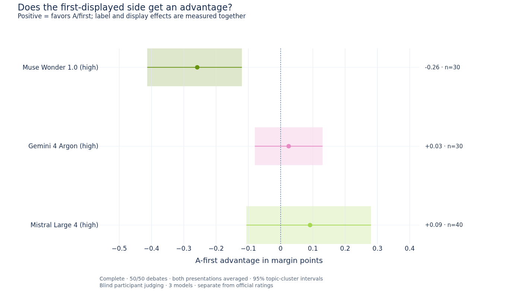
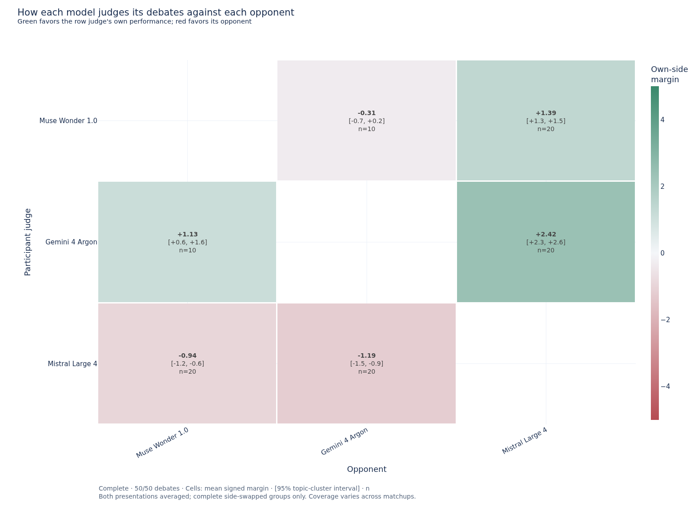

# Blind participant judging: 3 models

Complete analysis: **50/50 debates**, 25/25 side-swapped groups, 200/200 valid judgments. Each participant rated the same anonymous debate twice, with A/B labels and first-displayed side reversed within every round.

The primary quantity is the participant's **signed margin for its own side minus the independent panel's signed margin**, after averaging both presentations. Positive values mean a more favorable assessment of its own performance than the panel gave. This is a separate diagnostic; the official leaderboard is unchanged.

Margins range from −5 to +5 in each judgment. Brackets below show 95% confidence intervals from 2,000 topic-cluster bootstrap resamples. Averaged margins at least +0.5 count as own wins, at most −0.5 as opponent wins, and intermediate values as ties. The same rule is applied to the panel's mean raw margin.

| Participant judge | Debates | Own minus panel margin, 95% CI | Panel losses acknowledged | Winner flips across orders |
|---|---:|---:|---:|---:|
| Muse Wonder 1.0 (high) | 30/30 | -0.32 [-0.46, -0.15] | 4/5 (80%) | 5/30 (17%) |
| Gemini 4 Argon (high) | 30/30 | +0.66 [+0.44, +0.88] | 1/4 (25%) | 1/30 (3%) |
| Mistral Large 4 (high) | 40/40 | +0.79 [+0.52, +1.03] | 29/39 (74%) | 10/40 (25%) |

The largest observed own-minus-panel shift is **Mistral Large 4 (high): +0.79 [+0.52, +1.03]** margin points. The highest observed winner/tie agreement with the panel is **Muse Wonder 1.0 (high)**, at 26/30 (87%). These comparisons use each model's observed opponent mix.

## Presentation sensitivity

A-first advantage is half the difference between the margin a model gives its own side when shown as A/first and when shown as B/second. Positive values favor the first-displayed side. This measures the combined label/display effect; the two cannot be separated by this design. Averaging the two presentations cancels an additive preference for A-first.

| Participant judge | A-first advantage, 95% CI | Mean absolute margin change | Any verdict change, including ties |
|---|---:|---:|---:|
| Muse Wonder 1.0 (high) | -0.26 [-0.41, -0.12] | 0.55 | 5/30 (17%) |
| Gemini 4 Argon (high) | +0.03 [-0.08, +0.13] | 0.39 | 1/30 (3%) |
| Mistral Large 4 (high) | +0.09 [-0.11, +0.28] | 0.86 | 10/40 (25%) |

Two independent calls also introduce sampling variation. Differences between orders are therefore sensitivity measurements, not proof that every flip was caused by position bias.

## Model summaries

### Muse Wonder 1.0 (high)

Across 30 debates against 2 opponents, its average margin for its own side was +0.82, compared with +1.14 from the panel. The difference was -0.32 [-0.46, -0.15]; weighting each opponent equally gives -0.25. Its win/tie/loss calls for itself were 21/5/4.

It matched the panel verdict in 26/30 (87%), and acknowledged 4/5 (80%) of its panel-awarded losses. For 4/5 losses it chose the opponent in both presentations. The most favorable diagnostic shift relative to the panel was in **grounding and epistemic discipline**: +0.03 points of own-minus-opponent advantage on the 1–10 score scale. Reversing presentation changed the winning side in 5/30 debates and changed a verdict including ties in 5/30.

### Gemini 4 Argon (high)

Across 30 debates against 2 opponents, its average margin for its own side was +1.99, compared with +1.33 from the panel. The difference was +0.66 [+0.44, +0.88]; weighting each opponent equally gives +0.71. Its win/tie/loss calls for itself were 28/1/1.

It matched the panel verdict in 25/30 (83%), and acknowledged 1/4 (25%) of its panel-awarded losses. For 1/4 losses it chose the opponent in both presentations. The most favorable diagnostic shift relative to the panel was in **rebuttal quality**: +0.92 points of own-minus-opponent advantage on the 1–10 score scale. Reversing presentation changed the winning side in 1/30 debates and changed a verdict including ties in 1/30.

### Mistral Large 4 (high)

Across 40 debates against 2 opponents, its average margin for its own side was -1.07, compared with -1.85 from the panel. The difference was +0.79 [+0.52, +1.03]; weighting each opponent equally gives +0.79. Its win/tie/loss calls for itself were 1/9/30.

It matched the panel verdict in 29/40 (72%), and acknowledged 29/39 (74%) of its panel-awarded losses. For 28/39 losses it chose the opponent in both presentations. The most favorable diagnostic shift relative to the panel was in **rebuttal quality**: +0.80 points of own-minus-opponent advantage on the 1–10 score scale. Reversing presentation changed the winning side in 10/40 debates and changed a verdict including ties in 10/40.

## Judging each opponent

Every cell uses only debates between its row judge and column opponent. Positive margin favors the row judge's own debate side. Coverage varies across matchups; the matrix is not a new ranking.

| Participant judge | Opponent | Debates | Own-side margin, 95% CI | Opponent chosen | Opponent chosen in both orders |
|---|---|---:|---:|---:|---:|
| Muse Wonder 1.0 (high) | Gemini 4 Argon (high) | 10 | -0.31 [-0.72, +0.23] | 4/10 | 4/10 |
| Muse Wonder 1.0 (high) | Mistral Large 4 (high) | 20 | +1.39 [+1.26, +1.48] | 0/20 | 0/20 |
| Gemini 4 Argon (high) | Mistral Large 4 (high) | 20 | +2.42 [+2.25, +2.58] | 0/20 | 0/20 |
| Gemini 4 Argon (high) | Muse Wonder 1.0 (high) | 10 | +1.13 [+0.63, +1.60] | 1/10 | 1/10 |
| Mistral Large 4 (high) | Gemini 4 Argon (high) | 20 | -1.19 [-1.45, -0.93] | 16/20 | 15/20 |
| Mistral Large 4 (high) | Muse Wonder 1.0 (high) | 20 | -0.94 [-1.25, -0.63] | 14/20 | 14/20 |

## Mutual verdicts

The two participants reached the same winner/tie verdict in **36/50 (72%)** debates. Both chose themselves in 1/50; both chose the opponent in 0/50.

[Read illustrative judgment rationales, including the two orders side by side](examples.md). These are labeled examples selected by stated criteria, not a frequency estimate of argument themes.

## Protocol and limitations

- The frozen roster contains 3 models: Muse Wonder 1.0 (high), Gemini 4 Argon (high), Mistral Large 4 (high). The selection covers 3 of 3 possible pairings. Only debates between these participants are included. Results from different cohorts have different opponent mixes and should not be treated as a controlled comparison between cohorts.
- Each judgment is a fresh request with anonymous A/B transcript labels, no model identities, and no notice that the judge participated. Blinding does not establish that writing style is unrecognizable.
- Original turn numbers retain the speaking chronology while display order changes within each round. Actual debates also swap PRO and CON. This balances assignments across a matchup but does not separately identify PRO-role and original first-speaker effects.
- Only groups with two debates × two participants × two presentation orders enter the primary summaries. Currently 0 valid responses are excluded because their group is incomplete.
- The reference is each debate's frozen independent panel, averaged on its original raw −5 to +5 rubric; judge-normalized margins are retained separately in the balanced CSV. Its original single randomized presentation was not rerun. Self–panel differences may reflect rubric interpretation or scale use as well as self-favoring judgments.
- Reference-panel coverage: 50 debates with 3 reference judges. The model CSV also reports the mean shift after excluding whole side-swapped groups with fewer than three usable reference judges in either debate.
- Diagnostic subscores are 1–10 and remain secondary to the explicit winner and margin. Topic-cluster intervals keep both side swaps and repeated topic appearances together. They describe this observed schedule, not independent samples of individual judgments, and are not adjusted for multiple comparisons.
- Opponent coverage is unequal. Model summaries include the observed-debate mean and an equal-opponent mean as a sensitivity check. No participant judgments enter official rating calculations.

Source scope: `judge_judge_blend_mistral4_20261014_finalb__debate_all_templates`. Protocol: `participant-judging-2026-09-05a`. Recorded requests: 200 judging + 3 support probes. Summaries use no additional model calls.

Data: [frozen plan](plan.json), [coverage and provenance](summary.json), [all parsed judgments](raw_judgments.csv), [balanced debate judgments](balanced_debate_judgments.csv), [model summaries](model_summary.csv), [opponent summaries](model_opponent_summary.csv), [diagnostic scores](diagnostic_summary.csv), [mutual verdicts](mutual_verdicts.csv). Raw judgments are included under responses/. Exact prompts remain in the canonical benchmark archive.
